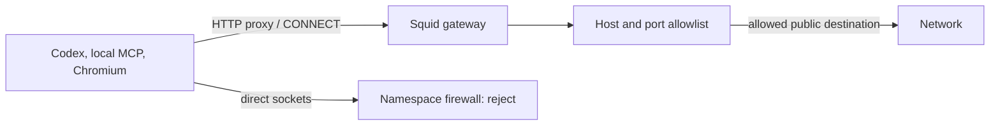

# Architecture and limits

The agent and gateway share a Docker network namespace using `network_mode: service:gateway`. Their filesystems and process namespaces remain separate. The gateway installs IPv4 and IPv6 OUTPUT policies before its healthcheck passes. Compose starts agent commands only after the gateway is healthy.

`src/main.rs` implements the host CLI, Docker/Lima orchestration, gateway rendering, and healthcheck. `src/policy.rs` handles strict JSON validation, matching, atomic policy saves, fingerprints, and Squid configuration. A single Rust binary provides these helpers on the host and in the gateway. The gateway image includes the compiled binary without Rust, Cargo, or Python.

Only the gateway proxy's kernel UID, 10001, can open outgoing network connections. The agent runs as UID 0 with a writable container filesystem, all Linux capabilities dropped, and privilege gains disabled. It therefore cannot assume UID 10001, modify firewall rules, or emit raw packets. This capability restriction maintains the egress boundary while allowing file edits throughout the container; it is not a workspace-only filesystem sandbox.

Loopback communication permits the proxy and local development servers. Docker's `127.0.0.11` DNS stub is explicitly rejected before the loopback rule because Docker rewrites DNS ports before OUTPUT filtering. Otherwise an agent could send arbitrary DNS queries through the host resolver. Squid performs permitted-host DNS lookups under its own UID.

Squid checks allowed hosts and ports, applies deny precedence, rejects nonpublic resolved destinations unless explicitly exempted, and ends with `http_access deny all`. `dstdomain -n` prevents a literal-IP request from acquiring permission through reverse DNS. Empty allowlists contain no allow rule. JSON validation prevents policy text from injecting Squid directives. Policy files are mounted only into the gateway, outside the writable workspace. See [Squid ACL documentation](https://www.squid-cache.org/Doc/config/acl/) and [Docker network mode documentation](https://docs.docker.com/reference/compose-file/services/#network_mode).

Gateway startup is fail closed: either both firewall families and a valid proxy start, or the healthcheck never permits an agent launch. Proxy shutdown leaves the namespace firewall in place for existing containers. Container processes cannot route around the proxy by changing their environment. New sessions check the running gateway's policy fingerprint against the validated host policy.

## Persistence and ownership

| Resource | Owner and lifetime |
| --- | --- |
| `config/network.json` | Host; changed by you or the allowlist CLI |
| `config/codex.toml` | Host template copied into each agent session |
| `/workspace` | Selected host directory; edits persist |
| `/root/.codex` | Project-specific Docker volume; login and history persist |
| Other agent files | Disposable container; removed when its command exits |
| Gateway rules | Its network namespace; reconstructed on startup |
| `.runtime/lima/codex-egress` | Optional dedicated test engine; independent of other VM homes |

The agent has no Docker socket, host network, host PID namespace, SSH agent, or host-home mount. The gateway has no workspace mount. Its listener binds only loopback, and no port is published. `./sandbox down` preserves credentials. To remove all state deliberately, run `docker compose down --volumes` against this project's compose file; that signs the sandbox out. Do not use global Docker prune commands for routine cleanup.

## What this guarantees

The runtime allowlist governs connections originating from the Codex container, including the CLI's own authentication/model requests and local browser/MCP child processes. HTTP/HTTPS clients must use the proxy. Direct outgoing sockets are rejected, including IPv6 and external DNS. Both public destination and private exception policies remain outside the agent's writable filesystem.

These guarantees assume the host Docker engine, gateway image, Squid, kernel isolation, and host-controlled policy are trusted. The setup is a development sandbox, not a defense against a kernel/container escape or a compromised proxy implementation. The sidecar's UID must not be assigned to an agent process. Do not add capabilities, privileged mode, host networking, other network attachments, or the Docker socket to the agent.

## Boundaries that remain

- An allowed destination may accept uploads, deletes, API writes, or arbitrary tunneled traffic on an allowed port. A destination firewall does not authorize individual operations.
- HTTPS contents and SNI inside a CONNECT tunnel are not inspected. Shared hosting and forwarding services can expose resources beyond the requested hostname. Use service credentials and permissions appropriate to the task.
- A permitted hosted connector or remote MCP service can make its own downstream requests outside Docker. These require that provider's controls. Hosted capabilities are off in the baseline.
- An agent can read its login state and mounted workspace and can change code that you later execute outside this container. Filesystem access is intentionally broad inside its container and selected workspace.
- Codex tool allowlists configure the exposed tools at session startup. Its copied configuration is writable inside the container; the gateway policy and firewall remain outside that filesystem. Hosted downstream behavior still requires the provider's permissions.
- The proxy must resolve permitted hostnames. DNS itself is trusted infrastructure; the runtime blocks the agent's direct DNS and checks private/reserved resolutions, but this is not a DNS-service policy or DNSSEC setup.
- Docker pulls, image builds, package repositories used by Dockerfile instructions, and VM provisioning use the trusted host/engine network. They are outside the running-agent policy.
- The Codex and Rust versions, Cargo dependency lockfile, and base-image digests are pinned. OS packages update on fresh builds; this is repeatable configuration, not byte-identical image reproduction. For immutable deployment, distribute the built image digest.

## Verification

Unit tests cover parsing, injection rejection, exact and suffix matching, deny precedence, private exceptions, empty allowlists, atomic CLI edits, and fingerprints. Live tests run in the actual container with its actual firewall. The separate runtime test project verifies policy reloads, private-address resolution, redirects, and proxy failure. No tests require a real API key, model inference, a host login, or another project.
